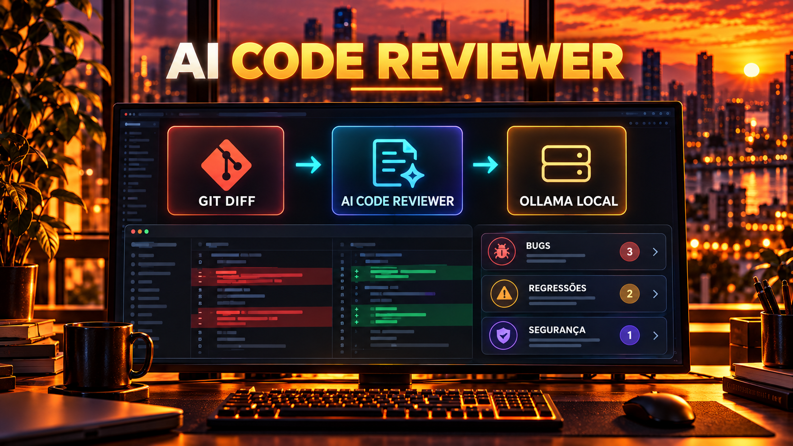

# 02 — AI Code Reviewer



A small, straightforward local code reviewer: it takes a Git diff, sends it to Ollama, and requests a review focused on bugs, security, and regressions. The response appears in the terminal; no files are changed.

## How It Works

```text
Git diff ──▶ App .NET ──HTTP──▶ Ollama / modelo local
                                  │
Terminal ◀── revisão em português ◀┘
```

The diff is size-limited and presented to the model as untrusted content, reducing the chance that instructions embedded in the code will derail the review.

## Prerequisites

- .NET 11 SDK
- Git no `PATH`
- Ollama installed and running
- One model downloaded, for example:

```bash
ollama pull llama3.2
```

## Run

From the repository root:

```bash
# Revisa mudanças ainda não staged
dotnet run --project 02-ai-code-reviewer/src

# Revisa somente o que já foi staged
dotnet run --project 02-ai-code-reviewer/src -- --staged

# Escolhe modelo e endpoint
dotnet run --project 02-ai-code-reviewer/src -- --model qwen3 --url http://localhost:11434
```

## Options

```text
--model <nome>             Modelo Ollama (padrão: llama3.2)
--url <endpoint>           URL do Ollama (padrão: http://localhost:11434)
--staged                   Usa git diff --cached
--max-diff-chars <número>  Limite de entrada (padrão: 24000)
--help                     Mostra a ajuda
```

If there are no changes to review, the program reports that and exits without calling the model. Large diffs are truncated with a visible warning.

## What You Will Learn

1. How to call a local LLM using `HttpClient` and Ollama’s REST API.
2. How to give a real development task context obtained from Git.
3. How to limit input and instruct the model to ignore instructions found in the content being analyzed.
4. Why AI review helps with triage but does not replace human review.

See [`SPEC.md`](SPEC.md) for the example requirements and limitations.
