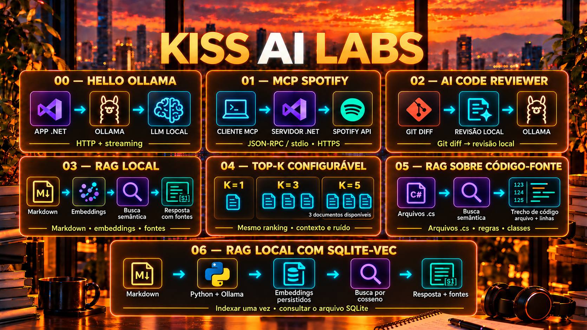

# 06 — Local RAG with SQLite-vec



Index Markdown documents once and reuse their text and embeddings in a SQLite file. Python calls Ollama over HTTP; the SQLite-vec extension calculates cosine distance in SQL. No external database service is required.

**Delivery status:** implementation and tests are prepared; validating the native extension and running the Ollama demo remain pending in this environment. See [VALIDATION.md](VALIDATION.md).

## Run

Prerequisites: Python 3.10 or later with `sqlite3` able to load extensions, SQLite 3.41 or later recommended, Ollama running, and the models below. Run from the repository root:

```bash
python -m venv .venv
```

Activate the environment in PowerShell with `\.venv\Scripts\Activate.ps1`, or on Linux/macOS with `source .venv/bin/activate`. Then:

```bash
python -m pip install -r 06-rag-sqlite-vec/requirements.txt
ollama pull nomic-embed-text
ollama pull llama3.2
python 06-rag-sqlite-vec/src/rag.py index --cpu
python 06-rag-sqlite-vec/src/rag.py ask --question "Como protegemos credenciais?" --top-k 1 --cpu
python 06-rag-sqlite-vec/src/rag.py ask --question "Por quanto tempo guardamos logs?" --top-k 2 --cpu
```

`--cpu` is optional: it sends `num_gpu=0` for both embeddings and generation. In previous labs, this resolved a token repetition failure observed with Ollama’s default run mode. Without this option, Ollama chooses how to run the models.

For your own documents:

```bash
python 06-rag-sqlite-vec/src/rag.py index --docs ./meus-documentos --db ./meu-rag.sqlite3
python 06-rag-sqlite-vec/src/rag.py ask --db ./meu-rag.sqlite3 --question "Qual é a política de retenção?"
```

The parent directory of `--db` must exist. The default file is `06-rag-sqlite-vec/rag.sqlite3`, which Git ignores. Use a database dedicated to this lab; SQLite files containing other tables are rejected.

## Indexing and Querying

```text
index: Markdown → Ollama /api/embed → textos + vetores float32 → rag.sqlite3
ask:   pergunta → Ollama /api/embed → distância de cosseno em SQL → Top-K
                                      → contexto + pergunta → Ollama /api/generate
```

`index` recursively searches for `.md` and `.MD` files, ignores empty files and symbolic links to files, and treats each whole file as a unit. The sample files cover credentials, retention, and deployment.

The index stores `documents` (relative path, text, and vector) and `metadata` (format, dimensions, embedding model, and endpoint). Queries use `vec_distance_cosine`, a SQLite-vec extension function, with `ORDER BY distance, path LIMIT K`: a smaller distance means a closer match. This is an exact table scan, suitable for this small lab; it does not use the `vec0` virtual table or an approximate index. See the [official KNN query documentation](https://alexgarcia.xyz/sqlite-vec/features/knn.html).

`ask` does not access the document folder: it generates only the question embedding, queries the persisted vectors, and makes a generation call. It prints paths, distances, `[S1]` IDs, the full context, and the response. Check the response against that context; model citations and claims are not validated automatically.

Did you modify, add, or remove documents? Run `index` again. Rebuilding generates all embeddings and replaces the previous set in a single transaction, without incremental updates. A failure during generation or writing preserves the previous index. Empty folders do not erase the previous index. The first failed run may leave an empty SQLite file that the next `index` run can reuse.

## Options

| Command | Option | Default |
|---|---|---|
| Both | `--db` | `06-rag-sqlite-vec/rag.sqlite3` |
| Both | `--url` | `http://localhost:11434` |
| Both | `--cpu` | Not set; Ollama chooses the device |
| index | `--docs` | Lab sample documents |
| index | `--embedding-model` | `nomic-embed-text` |
| ask | `--question` | `Como protegemos credenciais?` |
| ask | `--top-k` | 2; positive integer |
| ask | `--model` | `llama3.2` |

Use `python 06-rag-sqlite-vec/src/rag.py index --help` or `ask --help`. `ask` uses the embedding model recorded in the index and requires the same endpoint. Reindex to change the model or endpoint. A dimension change is rejected; an updated model with the same name and dimensions is not detected, so it also requires manual reindexing.

## Data, Limitations, and Common Failures

Full texts are sent to the endpoint for indexing; each query sends the question for embedding; the question and selected documents are sent for generation. With a local endpoint and models, this processing happens on the machine. A remote endpoint receives the texts. SQLite stores text and embeddings without encryption, and the terminal displays the context.

There is no chunking, minimum-similarity filter, question persistence, or token estimation. Large files may exceed the embedding window (truncation is disabled). Generation does not stream, has a 300-second timeout and a 384-token limit, and may stop before completing the response. A temperature of zero and a fixed seed do not guarantee accuracy.

- Missing dependency: install `requirements.txt` using the same Python interpreter that runs the lab. The version is pinned to `0.1.9` for reproducibility but still needs validation in this environment.
- Python without extension support: use a distribution that exposes `enable_load_extension`; see the [official Python guide](https://alexgarcia.xyz/sqlite-vec/python.html).
- Missing database: run `index` first. A folder without Markdown files does not modify the previous index.
- Missing model, network error, or timeout: check Ollama, downloaded models, and `--url`.
- Different model or dimensions: reindex with the desired configuration.
- Invalid arguments return exit code 2; runtime errors return exit code 1.

## Validate

```bash
python -m py_compile 06-rag-sqlite-vec/src/rag.py 06-rag-sqlite-vec/tests/test_rag.py
python 06-rag-sqlite-vec/tests/test_rag.py
```

The suite uses real SQLite-vec for persistence and ranking, and replaces only Ollama HTTP responses with controlled data. It does not require an Ollama service or downloaded models. If the extension is missing, native tests are skipped and the command returns 1 to indicate incomplete validation. The real demo above evaluates the semantic flow and should be run separately.

[Specification](SPEC.md) · [Validation Record](VALIDATION.md)
