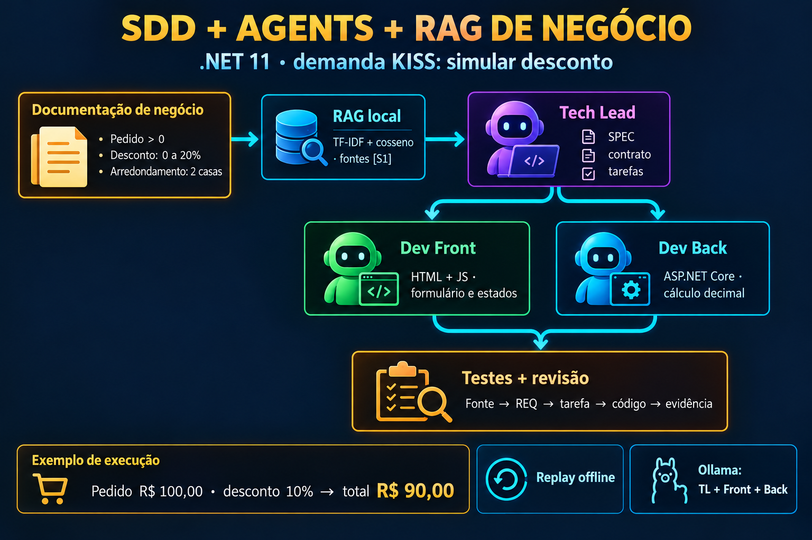

# 07 — SDD + agents + RAG de negócio



**Demanda KISS:** simular o valor final de um pedido com desconto de 0 a 20%. Stack: .NET 11, ASP.NET Core, C#, HTML/CSS/JS e Ollama opcional. Nenhum pacote externo.

O TL recupera documentação de negócio por RAG lexical (TF-IDF + cosseno), prepara uma SPEC candidata e delega tarefas delimitadas para Dev Front e Dev Back. Cada dev recebe a SPEC, o contrato, as fontes e somente sua tarefa. As propostas são gravadas para revisão; não são executadas automaticamente.

A aplicação de referência foi implementada por agents Front/Back separados durante esta entrega, com revisão independente. Ela pode ser executada sem Ollama.

## Executar a aplicação

Na raiz do repositório, com SDK .NET 11:

```bash
dotnet run --project 07-sdd-agents-business-rag/app
```

Abra `http://127.0.0.1:8087`. Informe 100 e 10; o resultado esperado é R$90,00. Desconto21% deve mostrar erro. A simulação não grava pedidos nem cobra valores.

Contrato: `POST /api/discount`, JSON `{ "amount": 100, "discount": 10 }`; sucesso `{ "original": "100.00", "discount": "10", "total": "90.00" }`; erro400 `{ "error": "mensagem" }`.

O backend usa decimal e arredondamento HALF_UP (AwayFromZero). O frontend preserva dinheiro como texto ao apresentar a resposta; se a conversão de uma entrada para número JSON mudaria seu valor decimal, recusa a entrada antes de chamar a API. O corpo JSON da API é limitado a4096bytes.

## Executar TL + Front + Back

Sem modelos, para estudar o fluxo:

```bash
dotnet run --project 07-sdd-agents-business-rag/src -- --offline
```

**Offline é replay de respostas preparadas, não uma geração de IA.** Ele usa o código de referência como proposta. Com Ollama em execução:

```bash
ollama pull llama3.2
dotnet run --project 07-sdd-agents-business-rag/src -- --model llama3.2 --cpu
```

O modo real faz três chamadas `/api/generate`: TL, Front e Back, com respostas JSON e validação de contrato, papéis e referências. `--cpu` envia `num_gpu=0`. Temperatura zero e seed fixa não garantem precisão; a fidelidade das regras/citações precisa de revisão.

Opções: `--offline`, `--cpu`, `--lab`, `--out`, `--model`, `--url`, `--top-k`, `--help`. K padrão3. A pasta do lab é descoberta a partir do executável. As saídas ficam em `runs/<horário UTC>/`, ignoradas pelo Git. Uma `--out` existente e não vazia é recusada.

## Kit completo da demanda

Leia [SPECKIT.md](SPECKIT.md) para a explicação do ciclo. A entrega inclui constituição, demanda, fontes de negócio, SPEC, esclarecimentos, pesquisa, plano, modelo de dados, contrato, tarefas, checklist, análise e convergência. É um kit autorado para esta demanda, alinhado ao processo do [Spec Kit oficial](https://github.com/github/spec-kit); seu CLI não foi instalado/executado nesta sessão.

Fonte de verdade: [SPEC canônica](../specs/lab-07-sdd-agents/SPEC.md). A SPEC emitida pelo modelo é candidata e não substitui a canônica sem revisão. Fontes → requisitos → tarefas → código → evidências permanecem separados.

Cada execução grava `sources.json`, `plan.json`, `SPEC.candidate.md`, `tasks.md`, `handoffs.json`, propostas `.html`/`.cs` e `review.json`. O último declara `generatedCodeExecuted=false` e `needs-human-review`.

## Validar

```bash
dotnet build 07-sdd-agents-business-rag/tests/LabTests.csproj
dotnet run --project 07-sdd-agents-business-rag/tests
node --test 07-sdd-agents-business-rag/tests/frontend.test.cjs
```

Os testes .NET verificam cálculo/handler HTTP nativos em memória, ranking, fontes, delegação, recusas e replay. Os testes JS usam DOM/fetch simulados; Node só é necessário para essa validação. [VALIDATION.md](VALIDATION.md) registra o que foi executado e o que depende de rede/navegador.

## Dados e limites

RAG fica em memória, com arquivos Markdown inteiros e busca lexical; não usa embeddings nem banco. No modo Ollama, a demanda, documentos recuperados e especificação são enviados ao endpoint configurado. As propostas/artefatos também são gravadas em disco. Endpoint remoto recebe esses textos.

O lab não executa código gerado nem resolve conflitos de negócio por conta própria. Referências válidas não provam fidelidade semântica. O servidor da aplicação e a revisão visual exigem acesso local; Ollama exige modelos. Timeout de geração3minutos e limite4096tokens por chamada. [Demanda](DEMAND.md) · [SPEC](SPEC.md) · [Kit](SPECKIT.md).
