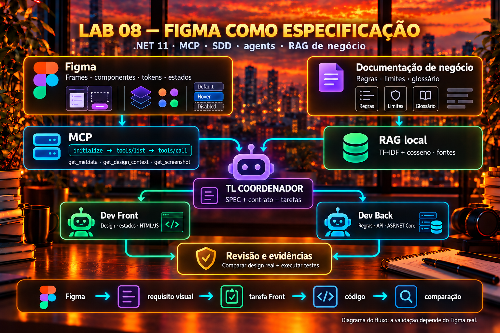

# Lab 08 — Figma as a specification through MCP



**Figma is a required part of the delivery.** It defines the visual specification; business documents define the rules; the TL combines both sources and delegates to Front/Back. Stack: .NET 11/C#, no external packages.

The reference design is [Figma — KissProject 4 Codex](https://www.figma.com/community/file/1691245874203095002/kissproject-4-codex?fuid=999015154036575904). This is the primary link confirmed by the user; the [editable copy](https://www.figma.com/design/L9IkL9GoyMixBb3bbUXihp/KissProject-4-Codex--Community-?node-id=0-1) and provenance are in [figma.source.json](figma.source.json). The user accepted delivery with the link if access is unavailable. **The content and real MCP integration have not yet been validated.** The image above explains the architecture; it is not a Figma capture. It has not been confirmed that a subscription is the cause of the limitation.

## KISS request

Evolve Lab 07's discount simulator with a Figma-specified screen: initial, calculating, success, error, and mobile. The contract/calculation remain in [Lab 07](../07-sdd-agents-business-rag/README.md); there is no new checkout, login, or database.

The kit details layout, tokens, labels, states, responsiveness, sources, and review criteria. The brief for creating/editing the file is a work instruction; only context extracted from Figma can approve the visual specification.

## Real integration implemented

The .NET client connects to the desktop MCP server and runs:

```text
initialize → notifications/initialized → tools/list
           → get_metadata → get_design_context → get_screenshot
```

It discovers schemas, passes `nodeId`, accepts JSON/SSE, propagates session/version, and rejects errors, missing tools, unknown arguments, and oversized responses. It does not execute received code.

Real prerequisites: Figma desktop with MCP enabled and the correct file open. See [FIGMA.md](FIGMA.md) and the [official guide](https://developers.figma.com/docs/figma-mcp-server/local-server-installation/). Connecting the Figma plugin to Codex does not automatically start this client's desktop server.

From the repository root:

```bash
dotnet build 08-sdd-figma-mcp/src/FigmaMcp.csproj
dotnet run --project 08-sdd-figma-mcp/src -- capture --node 0:1 --out 08-sdd-figma-mcp/runs/capture
```

Node 0:1 came from the link; its type still needs confirmation. If it is a page, use metadata to select relevant frames instead of assuming the whole page is a high-fidelity design.

`capture` requires textual context and a real screenshot with valid image data; it writes `capture.json`, `SPEC.visual-source.md`, and screenshots. It does not create the Figma file. Canvas creation/editing must happen through the authorized connector; that part of the delivery is pending.

## Figma + RAG → SPEC → agents

After capturing the frames:

```bash
dotnet run --project 08-sdd-figma-mcp/src -- spec --capture 08-sdd-figma-mcp/runs/capture/capture.json --cpu
```

The command reuses Lab 07's workflow, adds the `FIGMA` source, consults business sources, calls TL/Front/Back, and saves proposals. It requires the Front requirement and proposal to reference the design; it does not approve visual fidelity automatically. `SPEC.visual-source.md` preserves MCP context/metadata and a review checklist. The canonical source remains the [kit SPEC](../specs/lab-08-figma-mcp/SPEC.md).

Options: `capture`, `spec`, `demo`; `--node`, `--mcp-url`, `--capture`, `--out`, `--lab`, `--offline`, `--cpu`, `--model`, `--url`, `--help`. Default output goes to `runs/<timestamp>/`, ignored by Git; nonempty folders are rejected.

The standalone client uses `http://127.0.0.1:3845/mcp`. It does not implement OAuth for the remote server. The Codex plugin uses a different connection, with authentication and canvas-tool support, as described in the [remote guide](https://developers.figma.com/docs/figma-mcp-server/remote-server-installation/).

## Offline demo and tests

```bash
dotnet run --project 08-sdd-figma-mcp/src -- demo
dotnet run --project 08-sdd-figma-mcp/tests
```

`demo` combines a **fictional fixture, identified as `FIGMA-FIXTURE`, with agent replay**. It does not access Figma/Ollama, contain real IDs or screenshots, or replace delivery in Figma. MCP tests use a fake transport and check the protocol, schemas, errors, and limits without sockets. The reference calculation and frontend can run in Lab 07 while real visual integration is pending.

## Kit and data

Read [SPECKIT.md](SPECKIT.md), [SPEC](SPEC.md), [Figma guide](FIGMA.md), and [VALIDATION.md](VALIDATION.md). The complete request kit includes the constitution, research, clarifications, plan, data, design contract, tasks, checklist, analysis/convergence, and quickstart. The official Spec Kit CLI was not installed or run.

Figma context and screenshots are stored on disk. In real generation mode, textual design context, business documents, and the request are sent to the configured Ollama endpoint; this lab does not send screenshots to the model. A remote endpoint receives that text. Proposals are not run automatically. MCP timeout is 30 seconds per request; response limit is 4 MiB. Invalid capture or mismatch keeps the visual gate blocked.
