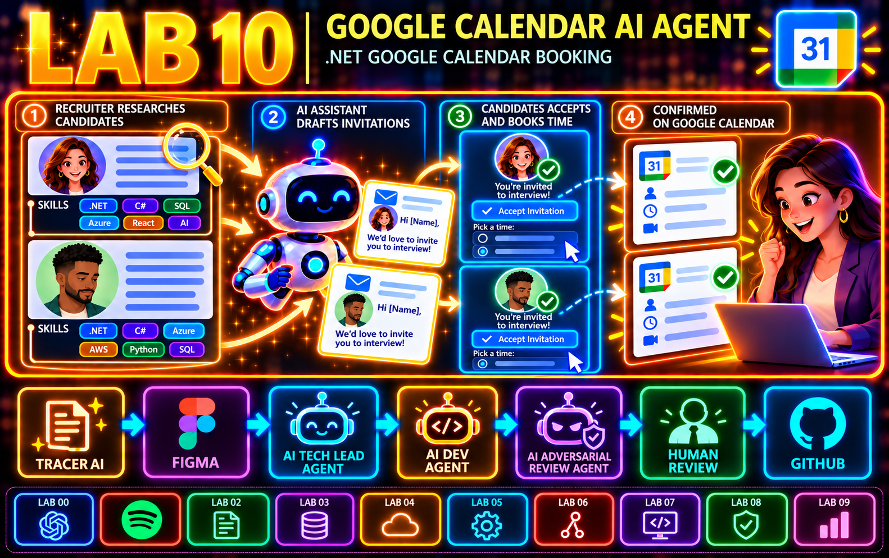

# KISS AI Labs

[**Visit the project site →**](https://ueidesantos.github.io/kiss-ai-labs/) — overview, labs, and project history.



**Hands-on local AI labs in .NET and Python: from your first call to an LLM to semantic search across your documents.**

Learn by building small C#/.NET 11 and Python applications: chat with models through Ollama, expose tools through MCP, review Git diffs, and ask questions about Markdown files with RAG. Lab 06 adds SQLite-vec persistence for embeddings. Each lab walks through the code, shows what's happening under the hood, and includes a specification to guide implementation.

[Run Lab 10](10-ai-recruiter-calendar/README.md) · [Get started](#get-started) · [Learning path](#learning-path) · [RAG demo](#featured-demo-local-rag) · [Roadmap](#roadmap) · [Contribute](#contributing)

> **Agent-driven software factory:** This repository includes a specification-driven development (SDD) workflow, team roles, and reusable templates. See [AGENTS.md](AGENTS.md) and [templates/sdd](templates/sdd/).

> **KISS — Keep It Simple, Stupid.** Small examples, explicit HTTP calls, and only a few moving parts make each step easy to understand. Complexity should serve the concept a lab teaches.

## Featured: Lab 10 — Google Calendar booking with .NET

**The reusable delivery path is Tracer AI → Figma → AI Tech Lead Agent → AI Dev Agent → AI Adversarial Review Agent → Human Review → GitHub.** Lab 10 uses that path as project context; its single .NET app focuses on Google Calendar booking. The recruiter shares relevant candidate skills and experience already gathered, reviews and sends the tailored Brazilian Portuguese invite, and the candidate books an available time. The app does not browse the web or collect candidate information automatically.

[Run Lab 10](10-ai-recruiter-calendar/README.md) · [Read the approved SPEC](specs/lab-10-google-calendar/SPEC.md) · [See the design decision](specs/lab-10-google-calendar/ADR-001.md)

The booking page is configured by the recruiter in Google Calendar and shared by link. Anyone with that link can view the booking page, so the recruiter should review its title and account/profile details before sharing. The lab uses fictional data and does not represent an approved production deployment for the SAM recruiter.

## Lab 09 — one AI builds, another reviews

[KISS AI Squad](09-ai-squad/README.md) combines SDD, business RAG, and Front/Back proposals with **adversarial review by another model**. Deterministic tests and critical findings block delivery; one correction round allows the candidate to be reevaluated. It includes a dashboard, a clearly labeled offline demo, and optional draft PR publishing. Agents work from structured proposals and controlled templates.

[Run Lab 09](09-ai-squad/README.md) · [Learn about Spec Kit](09-ai-squad/SPECKIT.md) · [Review validation results](09-ai-squad/VALIDATION.md)

### Lab 08: Figma as a specification

[Lab 08](08-sdd-figma-mcp/README.md) connects design, business documentation, and specification-driven development. The TL uses Figma context through MCP and RAG to delegate Front/Back work. It includes a .NET 11 client, a detailed kit, and an offline demo. The [design is available in Figma](https://www.figma.com/community/file/1691245874203095002/kissproject-4-codex?fuid=999015154036575904), with delivery by link accepted by the user. MCP capture and visual conformance have not yet been validated. [Lab 07](07-sdd-agents-business-rag/README.md) provides the working application and coordination workflow.

## Who this is for

- **.NET developers** who want to integrate AI into applications using C#, HTTP, and JSON.
- **Students and people transitioning into AI engineering** who want to understand generation, tools, and semantic search through runnable code.
- **Hands-on learners** who prefer reading a small program, changing an input, and seeing what happens.

Basic C#, terminal, and HTTP knowledge helps you follow along. These projects are educational; use them as a starting point for experiments and technical discussions.

## What you'll learn

| Concept | Hands-on experience |
|---|---|
| Local inference | Call Ollama with `HttpClient` and receive streamed responses |
| Tools for AI | Implement a teaching MCP server with JSON-RPC over stdio |
| Task-specific context | Send a Git diff to a model to help review code |
| Semantic search | Generate embeddings and rank documents by cosine similarity |
| RAG | Combine a question with retrieved documents to generate an answer |
| Limits and traceability | Compare Top-K values and inspect the files shown as sources |
| Specification-driven development | Connect `SPEC.md` requirements to application behavior |

These exercises let you practice decisions that come up in AI work: what context to send, where data is processed, how to integrate tools, and how to evaluate a response. To turn a lab into a portfolio project, record the prompt, observed result, limitations, and implementation decisions.

## Learning path

Follow the sequence **00 → 01 → 02 → 03 → 04 → 05 → 06 → 07 → 08 → 09 → 10**. Each lab is self-contained and has its own guide.

| Stage | Lab | What you build | Technologies and specific prerequisites |
|---|---|---|---|
| 00 — Foundations | [Hello Ollama](00-hello-ollama/README.md) | A console app that chats with an LLM and streams the response | .NET 11, `HttpClient`, Ollama, and a generation model |
| 01 — Tools | [MCP Spotify](01-mcp-spotify/README.md) | A server with tools to search for music and check current playback | .NET 11, JSON-RPC/stdio, Spotify Web API access, and a token |
| 02 — Practical app | [AI Code Reviewer](02-ai-code-reviewer/README.md) | A diff reviewer that suggests possible issues in the terminal | .NET 11, Git, Ollama, and a generation model |
| 03 — Local knowledge | [Local RAG](03-rag-local-memory/README.md) | Semantic search over Markdown, with Top-K and source listing | .NET 11, Ollama, embedding and generation models; in-memory vectors |
| 04 — Context and noise | [RAG with Configurable Top-K](04-rag-top-k/README.md) | Compare several K values using the same embeddings and ranking | .NET 11, Ollama, small Markdown documents |
| 05 — Source code | [RAG over Source Code](05-rag-source-code/README.md) | Semantic search over `.cs` rules and classes, with files and lines as sources | .NET 11, Ollama, in-memory embeddings |
| 06 — Persistence | [Local RAG with SQLite-vec](06-rag-sqlite-vec/README.md) | Separate indexing and querying, with vectors persisted in SQLite; native validation pending | Python, Ollama, SQLite-vec |
| 07 — KISS factory | [SDD + agents + RAG](07-sdd-agents-business-rag/README.md) | Complete request kit, TL delegating Front/Back, and discount simulator | .NET 11, ASP.NET Core, HTML/JS, Ollama optional |
| 08 — Design as a specification | [Figma MCP + SDD + agents](08-sdd-figma-mcp/README.md) | Capture a spec in Figma, combine it with business context, and delegate; real Figma gate pending | .NET 11, MCP, Figma, RAG, and agents |
| 09 — Independent review | [KISS AI Squad](09-ai-squad/README.md) | One model proposes, another reviews; tests, correction, and draft PR | .NET 11; two distinct Ollama models or the offline demo |
| 10 — Recruiter workflow | [AI Recruiter Outreach + Google Calendar](10-ai-recruiter-calendar/README.md) | A local model drafts a recruiter-reviewed candidate invite with a Google Calendar booking link | .NET 11, Ollama, and a Google Calendar appointment schedule link |

**Start with 00** to get up and running with the Ollama API. **Explore 03** to kick the tires on a complete demo of asking questions about documents. Lab 01 is the external integration example; Labs 00, 02, 03, 04, and 05 can use models running on your machine.

Lab 06 is implemented locally; native extension validation and publication are pending. Check the [validation record](06-rag-sqlite-vec/VALIDATION.md) before running it.

## Get started

### Prerequisites

- Git to clone the repository and run the diff reviewer.
- [.NET SDK](https://dotnet.microsoft.com/download) with `net11.0` support, the target framework for these projects.
- [Ollama](https://ollama.com/) installed and running for Labs 00, 02, 03, 04, 05, and 06.
- Enough disk space and memory for your chosen models. Response time depends on the model and hardware.
- For Lab 06, Python 3.10 or newer and the SQLite-vec extension, as described in its [guide](06-rag-sqlite-vec/README.md).
- For Lab 01, configure the Spotify token as described in the [MCP Spotify guide](01-mcp-spotify/README.md).

### Your first local conversation

```bash
git clone https://github.com/ueidesantos/kiss-ai-labs.git
cd kiss-ai-labs

dotnet --version
ollama pull llama3.2
dotnet run --project 00-hello-ollama/src -- --prompt "Explique RAG em três frases."
```

The console shows the model, endpoint, and generated response. From here on, run the commands on this page **from the repository root**. Keep Ollama running; the examples use `http://localhost:11434` by default.

## Featured demo: Local RAG

**Ask questions about local documents and see which files were retrieved.** Lab 03 uses sample notes on credential security, retention, and deployment to show how a question becomes a contextualized answer.

```text
Markdown files → embeddings via Ollama → in-memory vectors
                                                  │
Question → embedding → cosine similarity → Top-K documents
                                                  │
                       Question + context → Ollama → answer
                                                  + source list
```

### Run the demo

After the initial setup, download the embedding model and ask a question:

```bash
ollama pull nomic-embed-text
dotnet run --project 03-rag-local-memory/src -- --question "Como protegemos credenciais?" --top-k 1
```

In the terminal, inspect the retrieved files, their similarity scores, the answer, and the source list with identifiers such as `[S1]`, paths, and text previews. For the demo content, read the [credential security note](03-rag-local-memory/docs/seguranca.md): it recommends environment variables or a secrets manager and keeping credentials out of version-controlled code. The answer wording and ranking depend on the model; this is reference content, not a transcript of a run.

Compare the same question while retrieving more documents:

```bash
dotnet run --project 03-rag-local-memory/src -- --question "Como protegemos credenciais?" --top-k 3
```

What changed in the context sent to the model? Did the additional documents help, or did they add irrelevant information? This experiment makes the effect of Top-K visible. To compare `1,3,5` in one run and inspect all the context sent, follow [Lab 04 — RAG with Configurable Top-K](04-rag-top-k/README.md).

To use your own Markdown files:

```bash
dotnet run --project 03-rag-local-memory/src -- --docs ./meus-documentos --question "Qual é a política de retenção?" --top-k 2
```

### Current RAG scope

- Each Markdown file is indexed in full; chunking is not implemented yet.
- Embeddings are regenerated on each run and held in memory; there is no vector database.
- `--top-k` controls how many documents go into the context. There is no minimum similarity filter yet.
- The program lists the retrieved sources. It does not automatically validate citations written by the model against that list; check the file contents yourself.

[Read the full guide](03-rag-local-memory/README.md) · [Read the specification](03-rag-local-memory/SPEC.md)

## Where data is processed

In the Ollama labs, prompts and the text needed for the task are sent to the configured endpoint. In RAG, document content is sent to generate embeddings, and selected documents become part of the generation context. With a local endpoint and local models, processing happens on your machine; if you configure a remote endpoint, the text goes to that server.

MCP Spotify makes external calls to the Spotify Web API. Code reviews and RAG answers are model suggestions; check them against the diff and original documents.

## Structure and builds

Each lab follows a simple structure:

```text
NN-nome-do-lab/
├── SPEC.md     # Problem, requirements, limits, and acceptance criteria
├── README.md   # Setup, running the exercise, and concepts
└── src/        # Application source code
```

For changes spanning multiple labs or a new feature, the SDD factory defines roles, gates, and traceability in [AGENTS.md](AGENTS.md). Create `specs/<work-id>/` using the files in [templates/sdd](templates/sdd/); for small lab changes, keep `SPEC.md` with the lab.

Some labs also include `assets/` and sample documents. To build all projects, run these commands from the repository root:

```bash
dotnet build 00-hello-ollama/src/HelloOllama.csproj
dotnet build 01-mcp-spotify/src/McpSpotifyServer/McpSpotifyServer.csproj
dotnet build 02-ai-code-reviewer/src/AiCodeReviewer.csproj
dotnet build 03-rag-local-memory/src/RagLocalMemory.csproj
dotnet build 04-rag-top-k/src/RagTopK.csproj
dotnet build 05-rag-source-code/src/RagSourceCode.csproj
python -m py_compile 06-rag-sqlite-vec/src/rag.py 06-rag-sqlite-vec/tests/test_rag.py
dotnet build 07-sdd-agents-business-rag/tests/LabTests.csproj
dotnet build 08-sdd-figma-mcp/tests/McpTests.csproj
```

Building does not require loaded models or a Spotify token; running each scenario does require its prerequisites. Lab 04 includes an HTTP integration test that needs no models: `pwsh -File 04-rag-top-k/tests/validate.ps1`. Lab 05 also has an HTTP test: `pwsh -File 05-rag-source-code/tests/validate.ps1`. The repository does not yet have a CI pipeline or tests covering every lab.

Lab 06 has an offline suite using real SQLite-vec: `python 06-rag-sqlite-vec/tests/test_rag.py`. Install its `requirements.txt` first. If native tests are skipped, the command returns 1 to indicate incomplete validation.

## Roadmap

The [backlog](BACKLOG.md) lists the labs maintained in this learning path and their dependencies. Current status:

| Status | Deliverable | Next learning step |
|---|---|---|
| Available in Lab 03 | In-memory RAG, configurable Top-K, and source listing | Understand the full flow and inspect retrieved context |
| Available in [Lab 04](04-rag-top-k/README.md) | Compare Top-K values in one run, with full context and sources | Evaluate relevance and noise while reusing embeddings |
| Available in [Lab 05](05-rag-source-code/README.md) | RAG over C#/.NET source code | Find rules, classes, and validations in `.cs` files |
| Implemented; validation and publication pending | [Persistence with Python and SQLite-vec — Lab 06](06-rag-sqlite-vec/README.md) | Reuse embeddings in a local database |
| Core tested; real integration/publication pending | [SDD + agents + RAG — Lab 07](07-sdd-agents-business-rag/README.md) | Specify, delegate, and validate a KISS request with traceability |
| MCP client tested with mocks; design available by link | [Figma as a specification — Lab 08](08-sdd-figma-mcp/README.md) | Derive visual requirements from the design and coordinate Front/Back |
| Implemented; see the evidence | [KISS AI Squad — Lab 09](09-ai-squad/README.md) | Separate development and adversarial model review, then validate the candidate |
| Build verified; live booking not tested | [Google Calendar booking with .NET — Lab 10](10-ai-recruiter-calendar/README.md) | Draft a candidate invitation with the recruiter’s booking link |

### Repository improvements

1. **Quality:** automate builds with GitHub Actions, add useful tests, and publish a badge linked to the workflow once it exists.
2. **Demos:** record real outputs, screenshots, or short videos for Lab 03, including the model used and observed limitations.
3. **Contributions:** create issue and PR templates and organize roadmap tracking.
4. **Sharing:** publish tutorials and case studies with reproducible steps and links to the relevant labs.

## Contributing

Found a bug or have an idea? [Open an issue](https://github.com/ueidesantos/kiss-ai-labs/issues) with the lab, goal, and steps to reproduce the behavior. For runtime issues, include your operating system, SDK version, model, and error message—never include tokens or credentials.

To propose a change or a new lab:

1. Check the [backlog](BACKLOG.md) and issues to understand the scope.
2. Describe the problem and acceptance criteria in `SPEC.md`.
3. Keep the example small, with an easy-to-follow main flow.
4. Document prerequisites, run commands, usage examples, and limitations in the lab README.
5. Build the project and describe what you validated in the PR, including any step you could not run.

Other useful contributions include fixing instructions, improving error messages, and sharing experiments that compare models or retrieval results.

## Next step

Run [Hello Ollama](00-hello-ollama/README.md) to get started, or try the [RAG demo](#featured-demo-local-rag) with one of your questions. As you explore a lab, record what changed between attempts: question, model, retrieved context, and answer quality.

## License

Use it for learning.
