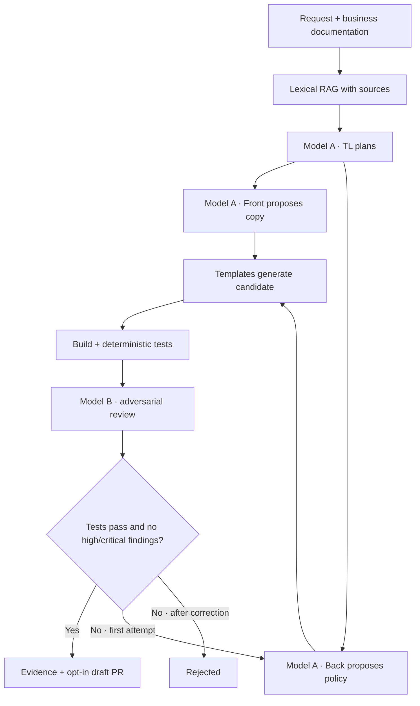

# Technical plan

The coordinator checks that names and digests differ before real calls. TL, Front, and Back share the developer model; review uses the second model. The runner coordinates sequential steps without claiming general autonomy or parallelism.

## Responsibilities

Coordinator/TL sets scope and contracts; Front/UX handles copy and states; Back maintains the decimal domain and templates; adversarial QA receives evidence, records findings, and reevaluates the single allowed correction. Tests and approval rules remain outside both models' control.

## Failures and rollback

An invalid response, unavailable service, or severe review finding prevents approval. Artifacts stay in their own directory; the canonical SPEC is not overwritten. The publication script verifies the manifest and gate, creates a separate draft PR, and never merges. To discard a published candidate, close its PR.

The cover features Lab 09 while preserving the scene and reference to Lab 08. Validation and limitations are listed in [convergence.md](convergence.md).
