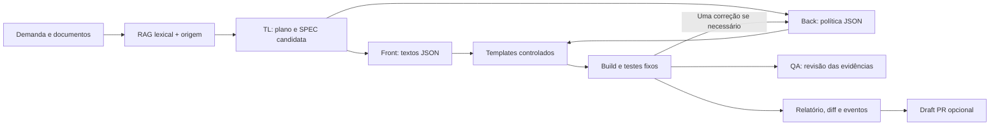

# Plano técnico

O runner coordena etapas sequenciais. A aplicação ASP.NET Core fornece o simulador e o painel. A biblioteca de domínio concentra a regra de dinheiro; o harness console verifica a regra sem frameworks de teste externos.

## Responsabilidades e dependências

- Coordenador/TL: demanda fixa, fontes, contratos, rastreabilidade e integração.
- Front/UX: perfil explícito, limites visíveis, estados acessíveis e painel sem alegações enganosas.
- Back/arquitetura: domínio decimal, validação de propostas e materialização controlada.
- QA: cenários independentes, revisão adversarial e comunicação de limitações.

Primeiro estabilizar regra e contratos; depois app e runner; então validar offline, falhas e modo real quando disponível; por fim atualizar capa, catálogo e publicação. Lab 08 permanece o principal destaque visual.

## Falhas e reversão

Saída inválida de modelo, falta de contexto ou erro de transporte deve encerrar com erro claro. Resultado reprovado não habilita publicação. Artefatos de uma execução ficam em diretório próprio, sem sobrescrever a SPEC canônica. Para desfazer a entrega opcional, fechar o draft PR; nenhuma integração automática ocorre.
