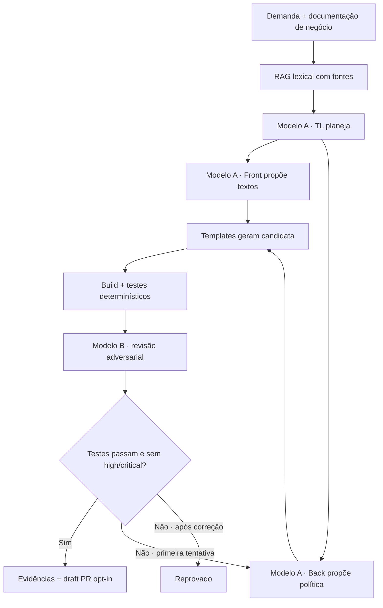

# Plano técnico

O coordenador verifica nomes e digests distintos antes das chamadas reais. TL, Front e Back compartilham o modelo desenvolvedor; a revisão usa o segundo modelo. O runner coordena etapas sequenciais, sem afirmar autonomia geral ou paralelismo.

## Responsabilidades

Coordenador/TL fixa escopo e contratos; Front/UX cuida de textos e estados; Back mantém domínio decimal e templates; QA adversarial recebe evidências, registra achados e reavalia a única correção permitida. Testes e regras de aprovação ficam fora do controle de ambos os modelos.

## Falhas e reversão

Resposta inválida, indisponibilidade ou revisão grave impede aprovação. Artefatos ficam em diretório próprio; a SPEC canônica não é sobrescrita. O script de publicação verifica manifesto e gate, cria draft PR separado e nunca faz merge. Para descartar uma candidata publicada, fechar seu PR.

A capa dá protagonismo ao lab 09, preservando o cenário e a referência ao lab 08. Validação e limitações constam em [convergence.md](convergence.md).
